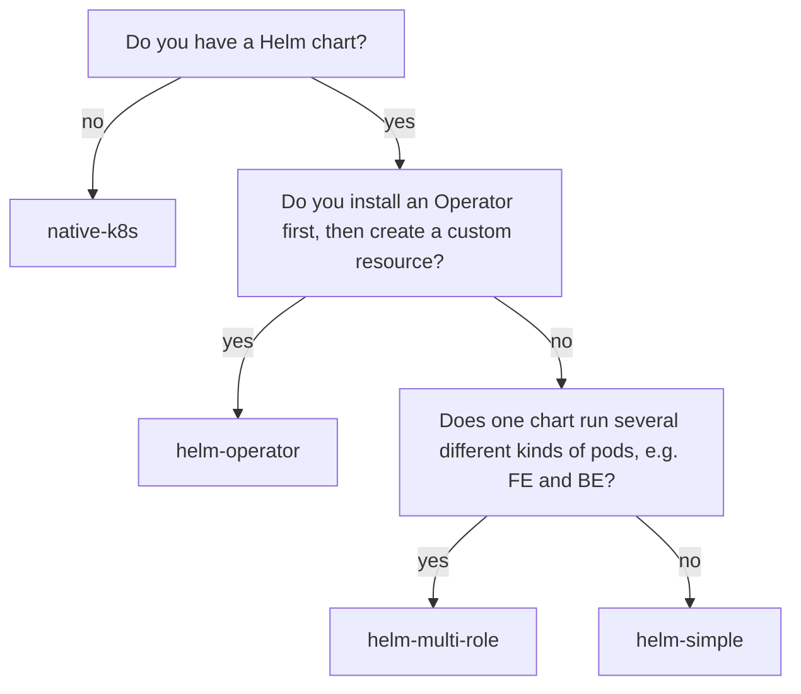

# Which template should I choose? (`engine.template`)

Answer in order and stop at the first **yes**:

| Template | Use when | Real-world examples | What you also provide |
|---|---|---|---|
| `helm-simple` | One chart, one kind of workload. Pods are alike. | Neo4j, Grafana, Redis, MinIO, Superset, a REST API | `helm.*`, `images` |
| `helm-multi-role` | One chart, several pod types with their own size | StarRocks (FE/BE), PuppyGraph (controlplane/leader/compute), Trino (coordinator/workers), Druid, Pinot | the above + `engine.roles: [{name, replicas}, ...]` |
| `helm-operator` | Install an operator (and its CRDs), then apply a custom resource | CloudNativePG (Postgres), Strimzi (Kafka), Flink/Spark operators, ECK | the above + `operator.*` (chart, CRD group/kind) |
| `native-k8s` | No Helm chart; plain Deployment/Service YAML | In-house service, proof of concept | `images` only (no `helm.*`) |

## How to tell from your chart
- `values.yaml` has top-level sections such as `fe:` / `be:` or `coordinator:` / `worker:` -> **multi-role**.
- Install docs have two steps ("install the operator", then `kubectl apply -f cluster.yaml`) -> **operator**.
- Chart installs `CustomResourceDefinition`s -> **operator**.
- Nothing but a chart with one Deployment/StatefulSet -> **simple**.

## Ready-made examples to copy
| Pattern | File |
|---|---|
| helm-simple | `examples/neo4j.input.yaml` |
| helm-multi-role | `examples/starrocks.input.yaml`, `examples/puppygraph.input.yaml` |
| helm-operator | `examples/phoenixai.input.yaml` |
| native-k8s | `examples/dataspark/api.input.yaml` |

Picked wrong? Change the one `template:` line (and add/remove `roles` / `operator`) and run
`./awc build` again. Nothing else is lost.
