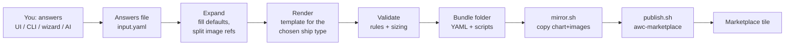

# How it works: inputs → processing → output

**One sentence:** you describe your app (name, Helm chart, images, ports, sizing, registry);
the toolkit turns that description into the exact Kubernetes/AWC files the Marketplace needs,
checks them, and gives you scripts to copy the artifacts and publish.



## 1. What you provide (inputs)

| You answer | Example | Used for |
|---|---|---|
| **Identity**: id, owner, display name, description | `neo4j`, "Neo4j, Inc." | Names of every resource and the Marketplace tile text |
| **How it ships** (template) | `helm-simple`, `helm-multi-role`, `helm-operator`, `native-k8s` | Chooses which Engine template is rendered |
| **Helm chart**: repo URL, chart, version | `https://helm.neo4j.com/neo4j`, `neo4j`, `5.26.0` | ChartCatalog + the HelmRelease inside the Engine |
| **Container images** | `docker.io/neo4j:5.26.0-community` | ImageCatalog + mirror list + image values |
| **Roles** (multi-role only) | `fe`, `be` with replicas | Per-role settings users can tune |
| **Service**: port, web UI port | `7687`, `7474` | Service, HTTPRoute (landing page link) |
| **Capability** (optional) | `neo4j-connection: host, boltPort` | Contract other engines can consume |
| **Dependencies** (optional) | `hive-metastore` (auto / optional / ref) | Engine dependencies and Blueprint instances |
| **Cluster sizing** | min 4 CPU / 16Gi, disk | ClusterRequirements, validator warnings |
| **Publish**: registry + namespace | `registry.example.com` / `neo4j` | Where mirror/publish scripts push |

Defaults are conveniences, not verified environment settings. In particular the
publish registry defaults to a placeholder; `engine.description` and (when
enabled) `blueprint.outcome` must be supplied to the file workflow. See the
[actual key checklists and edit commands](ONBOARDING_GUIDE.md#engine-input-checklist)
before building. Source configuration is YAML, not `.env`; never edit generated output.

## 2. What happens to them (processing)

1. **Collect** – the guided UI/wizard asks only questions that apply to your earlier answers
   (e.g. operator questions appear only for `helm-operator`). The MCP server does the same for an AI.
   File-based answers live in your own `*.input.yaml`; guided answers are saved
   in runtime session JSON. Keep a source YAML for repeatable file-based runs.
2. **Expand** (`manifest.py`) – fills defaults, splits `registry/repo:tag` image refs, creates per-role fields,
   computes landing-page host, merges advanced options (`docs/ADVANCED_OPTIONS.md`).
3. **Render** (`generator.py` + `templates/`) – Jinja templates for your chosen ship type produce the files.
   Values users may change at install time become the Engine's `configSchema`; chart/image coordinates
   come from the catalogs so nothing is hard-coded.
4. **Validate** (`validator.py`) – checks YAML, required fields, apiVersions and kinds, `:latest` tags,
   forbidden internal registries, node sizing for multi-role engines. Errors block; warnings advise.
5. **Compose** (optional) – for multi-engine apps, `blueprint_composer.py` renders each engine, then writes
   ONE Blueprint listing all of them plus any `existing:` marketplace engines (CDE, CAI, CDF…), and one `publish.sh`.

## 3. What you get (outputs)

Folder such as `output/neo4j/` (pre-built copies in `examples/bundles/`):

| File | What it is | Who uses it |
|---|---|---|
| `engine.yaml` | The Engine: how to deploy, user config schema, what it provides, health checks | AWC at install time |
| `blueprint.yaml` | The Marketplace tile: name, outcome, which engines/instances | Marketplace |
| `chartcatalog.yaml` / `imagecatalog.yaml` | Pinned Helm chart and image locations per version | Engine templates |
| `capability.yaml` | Contract other engines can depend on (if you exported one) | Other engines |
| `clusterrequirements.yaml` | Min/recommended nodes, CPU, memory, disk | Cluster provisioning |
| `role.yaml` | RBAC the Engine needs | Cluster |
| `mirror.yaml` + `mirror.sh` | List and script to copy chart and images to your registry | You (once per version) |
| `publish.sh` | `awc-marketplace validate` / `publish` (dry run by default) | You |
| `examples/instance.yaml` | Ready-to-apply EngineInstance with default config | You (test install) |
| `examples/smoke-test.sh` | `kubectl` checks that it came up | You |

## 4. Worked example (Neo4j)

Input (`examples/neo4j.input.yaml`, 10 lines):
```yaml
partner: {id: neo4j, owner: "Neo4j, Inc."}
engine: {template: helm-simple, version: "5.26.0", displayName: "Neo4j"}
helm: {repoUrl: "https://helm.neo4j.com/neo4j", chart: neo4j, version: "5.26.0"}
images: [{id: neo4j, ref: "docker.io/neo4j:5.26.0-community"}]
service: {port: 7687, hasLandingPage: true, landingPort: 7474}
publish: {destinationRegistry: "registry.example.com", namespace: neo4j}
```
`./awc build examples/neo4j.input.yaml` →

- chart → `chartcatalog.yaml` (registry + `neo4j/charts/neo4j`, version 5.26.0)
- image → `imagecatalog.yaml` and a HelmRelease `image.repository` pointing at your registry
- port 7474 → HTTPRoute + a `landingPage` capability (the clickable tile link)
- port 7687 + capability fields → `neo4j-connection` for other engines
- registry → `mirror.sh` / `publish.sh` target
- validator: ✅ or a list of fixes

Then: `./mirror.sh` → `./publish.sh --push` → the tile appears in the Marketplace.

## 5. What it does NOT do

It does not build images or Dockerfiles, run the real `awc-marketplace`/`helm`/`skopeo` for you
(it generates scripts you run), or approve/mark an engine Supported. It checks files statically; a real
cluster install is still the final test (`examples/smoke-test.sh`).
